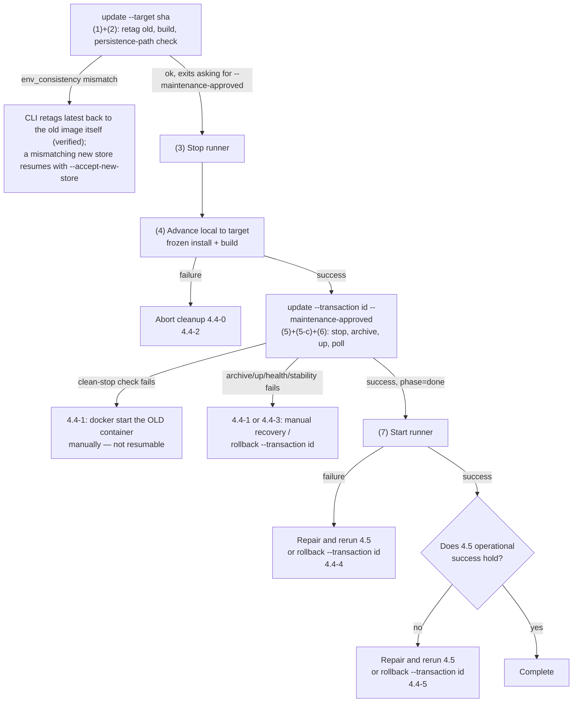

# Server update and rollback

The normative reference for why each step is shaped this way is
[Multi-host deployment architecture](../architecture/deployment.md). Deploy
CLI config keys and transaction states are documented in full in
[Server deploy configuration](../reference/configuration/server-deploy.md);
build-identity provenance verification is in
[Transactions and identity](../reference/deployment/transactions-and-identity.md).
This page covers the server side; the interleaved runner-side steps are in
[Runner update and rollback](runner-update-and-rollback.md).

Sections 1–2 cover **initial deployment**. This section is canonical for moving
an already-running deployment to a new version.

> **The server side is a CLI** (`server/deploy/kaoiro-server-deploy.mjs`,
> issue #306), driven by a transaction manifest + journal — [4.3](#43-update-procedure)/[4.4](#44-failure-handling) below
> document it. **The runner side remains a separate, still-manual (or
> checkout-direct) procedure** interleaved with the CLI calls; [4.6](runner-update-and-rollback.md#46-migrate-to-the-release-profile-and-update-thereafter-issue-219) covers the
> release-profile automation for it. Automation does not remove the [4.1](../architecture/deployment.md#build-and-restart-boundaries)
> limits by itself — they remain until their own resolving condition is met.

## 3. Connectivity checks

1. server: verify with `docker compose ps`; open the dashboard at
   `https://<host>/?token=<token from KAOIRO_CLIENT_TOKENS>`.
2. runner: startup logs show `runner: host=<host_id> rev=<40-hex-sha> connecting
   to wss://...` without repeated disconnects (auth failure disconnects
   immediately as `unauthorized`). Check the running invocation's full startup
   record; a `-dirty` revision is not an accepted release identity.
3. Confirm the host list in the dashboard contains the `host_id`.

Issue 564's backend preparation reads the active runner invocation for its
`runner: host=<host_id> rev=<40-hex-sha> connecting to ...` startup record. If
the complete invocation has no unique, well-formed record, or its journal
output exceeds 8 MiB, preparation stops with
`runner-start-record-unavailable`. A `-dirty` revision stops with
`runner-identity-dirty`. The command never restarts the service. A controlled
restart creates a new startup record but stops supervised wrappers and
interrupts active turns; defer preparation if that impact is not acceptable.
See the [backend switching procedure](codex-backend-switch.md#preparation-before-a-default-change).
The synchronous `execFileSync` capture reports this overflow as `ENOBUFS`;
U1 preserves that error through the command boundary and maps it to
`runner-start-record-unavailable` when reading the startup record.

### Update-related resolved limits

**Missing artifact provenance (former #218) is resolved**: build identity
([ADR-0053](../adr/0053-build-identity.md)) exposes the full SHA through the
health endpoint and runner registration data (4.5).

**Manual-only rollback (former #220) is resolved**: `server/deploy/kaoiro-server-deploy.mjs
rollback --transaction <id> --confirm-restore` (4.4) restores the old image and its
corresponding pre-deploy archive as one unit, re-verifying the archive and the
restored volume's contents before starting the old image. It is operator-invoked,
not automatic — the CLI never rolls back on its own — but every mechanical step
(stop, forensic-archive, verify, wipe, restore, retag, start, health poll) that used
to be manual SSH commands is now one command.

**In-place build is resolved in the release profile** ([ADR-0018](../adr/0018-runner-distribution.md),
revised 2026-08-16). Releases expand to `releases/<revision>/` and the live path
is one `current` symlink, so **build and expansion never touch a running runner**.
This remains **a host installation-shape issue** rather than a code-only fix:
hosts whose `ExecStart` points directly to a repo checkout retain the limit until
they complete the 4.6 migration.

## 4. Update and rollback

### 4.2 Preconditions

Satisfy all of the following before starting.

If the target release includes the Codex omitted-backend default change, complete
the preparation command introduced for
[issue 564](https://github.com/sakuraiyuta/kaoiro/issues/564) on the affected
host before deploying that runner release. The observation helper is read-only
and adds no DETS schema or rollback state; use the [Codex backend preparation
runbook](codex-backend-switch.md#preparation-before-a-default-change) for the
applied-selection and origin checks. A server update alone does not complete
runner preparation.

- **Pin the target to a full 40-character SHA.** Do not depend on `git pull`; record
  the SHA in the change log.
- **Advance both server and runner to the same target.** Advancing one side alone
  breaks the same-SHA postcondition and runs an unverified combination.
- **Check source cleanliness for tracked and untracked files.** `git diff --quiet`
  misses untracked files; require empty `git status --porcelain` output.
- **Ensure the server host's SSH host key is in `known_hosts`.** Do not bypass with
  `StrictHostKeyChecking=no`.
- **Ensure every persistence path resolves under the named volume.** The source of
  truth is the persistence set in 1.2. An unlisted DETS can **silently escape backup**
  (`KAOIRO_USERS_PATH` did so, losing the user ledger on container recreation;
  issue #217).
- **Know which persistence stores are new in the target image.** A store
  absent from the old manifest is eligible for `--accept-new-store <ENV_NAME>`
  only when the old image advertises the supported exhaustive and stable store
  contract. The operator must independently establish that no earlier data
  needs migration; the CLI cannot prove the absence of historical data. See
  4.3 (2) and the 4.3 (5-b) paragraph that begins
  "For a genuinely new store".
- **Confirm there is no active work** (human judgment). Stopping a runner stops all
  wrappers beneath it (section 2, “Run as a service”); conversation state is not
  persisted, so in-progress exchanges are lost.
- **The deploy host's `tar` must be GNU tar.** The CLI's own archive-listing
  parser assumes GNU `tar tv*`'s output format; a bsdtar or busybox host fails
  loudly (a parse error, not a silent misread) once the archive has already
  been written.
- **A destructive rollback refuses, in its preflight, a manifest whose
  `required_entries` do not match the archive's current `LC_ALL=C` listing**,
  before any stop, archive, or wipe. In practice this is a manifest that
  recorded a non-ASCII entry name in unescaped UTF-8, as listings made before
  issue #552 under a UTF-8 locale did. Such a transaction is not restored
  automatically.
- **Use exactly one `backup_root` per deployment host.** The single-writer
  lock every mutating command (`start`/`update`/`rollback`) takes lives under
  `backup_root`, keyed by the checkout's own path — two DIFFERENT
  `backup_root` values for the SAME checkout get two INDEPENDENT locks, so a
  concurrent run against the same deployment would not be caught. Keep the
  `--config` file's `backup_root` the same across every invocation on a host
  (the default, `~/kaoiro-deploy`, already satisfies this without a config
  file at all).

#### Child tool environments

The CLI's Git commands use the closed `git` profile; health curl and archive
tar commands use `authority`. Their `CHILD_PATH` starts with the current Node
executable's directory, followed by `/usr/local/bin:/usr/bin:/bin`; locale is C.
See the [child environment contract](../reference/security/enforcement-boundaries.md#child-process-environments) for
profile authority. Git keeps repository-local configuration and normal
HOME/session-based SSH access, while global/system Git configuration,
ambient Git overrides and HTTP tokens are excluded.

Health curl keeps normal HOME-based configuration and system CA lookup.
`KAOIRO_DEPLOY_CURL_BIN` can select an absolute executable; default tool names
must resolve on `CHILD_PATH`, including tar's gzip dependency. Ambient proxy,
`CURL_HOME` and custom-CA variables are excluded. Environments requiring those
variables will fail health polling until configured compatibly with the
existing profile. Configuration files and explicitly selected tools retain
their own authority. Docker selection and configuration remain in the
separate Docker helper.

### 4.3 Update procedure

The server side is `server/deploy/kaoiro-server-deploy.mjs` (issue #306): one
command per step, backed by a transaction manifest + journal under
`backup_root` (default `~/kaoiro-deploy/`). Run it as a normal user directly on
the server host, inside its checked-out repo — it runs every `git`/`docker`
call itself. Unlike the old manual runbook, **none of the commands below are
wrapped in `ssh '...'`**: log into the server host once for the CLI calls,
and separately into the relevant runner host for (3)/(4)/(7)
(section 2 covers multi-host runner deployment; a single-host lab setup may
have both be the same machine).

```sh
node server/deploy/kaoiro-server-deploy.mjs <command> [flags...]
```

Deploy CLI `--config` keys are documented in [Server deploy configuration](../reference/configuration/server-deploy.md).

**`update --dry-run --target <target-sha>` performs only reads.** It never
fetches from `origin` (issue #322 S1) — an EARLIER version did, which mutated
the checkout's remote-tracking refs and object store despite `--dry-run`'s
own read-only contract. It instead checks whether `target` is already a known
commit object in the LOCAL repo (`git cat-file -e`, no network at all) and
reports that under `targetKnownLocally` alongside `fetched: false` — an
explicit signal that this reflects refs as of the last real `git fetch`, not
a live query. Run a real `git fetch origin` yourself first if the answer
needs to be current.

A non-dry `update` fetches `origin` inside `runBuild` before its fast-forward
merge. The dry-run plan includes that future fetch without performing it.

### Delivery policy revision recovery

After restoring the delivery-policy store from a backup, a live wrapper may
report `delivery_policy_revision_below_high_water` with the received revision
and its retained `high_water`. It rejects that lower row without an ack and
stays fenced on a supporting rejoin. Normal root delivery remains available.

Verify the restored store and effective policy first, then restart the
affected wrappers through the normal operator stop/restore procedure. A new
wrapper process has no prior high-water and applies the restored current row
before acknowledging it. Confirm its matching current-revision ack and an
eligible on/off control. Do not edit wrapper history, reset a policy on a
timer, or treat a reconnect as recovery. For a wrapper release use the
[high-risk canary procedure](high-risk-change-release.md).

### Delivery policy store placement

When the prepared target declares `delivery_policies`, `update` checks its
placement after env consistency and before checking `--maintenance-approved`.
This runs on both matched paths and explicitly accepted new-store mismatches,
and runs again when resuming an already checked transaction. A dry-run does
not create a target/probe or claim this check passed.

The target release's actual `DeliveryPolicies.resolved_path()` must equal the
effective Compose `KAOIRO_DELIVERY_POLICIES_PATH`. Its deepest containing mount
must be the writable named `/var/lib/kaoiro` volume already used for backups.
Temporary/outside paths, dot components, symlinks, unreadable components,
nested bind/tmpfs/different volumes and incomplete inspection refuse the
update before maintenance or stop. Image VOLUME declarations at or under the
state target refuse even if Compose would override them; that precedence is
not inferred from unmeasured cases. A non-shadowing sibling mount is allowed.

The check observes Compose volumes and service `tmpfs:` plus image VOLUME,
then inspects both `.Mounts` and `HostConfig.Tmpfs` in a uniquely named
one-shot target container with no network or published ports. Existing mounts
are read-only; named volumes use `volume-nocopy`. The release is evaluated
without starting the server/application or opening its DETS store. Only the
owned probe and its anonymous volumes are removed. Probe/cleanup failures are
refusals, and a refused prepare restores the old `latest` image tag.
Mountpoints for sibling mounts inside the state volume must already exist;
the read-only probe refuses if Docker would need to create them there.

`policy-store-placement.json` binds the transaction, target image, effective
Compose/environment digests, runtime path, full normalized mount table,
selected volume and Docker/Compose versions. Its path/hash is checkpointed
in the prepare journal before returning maintenance-required exit 64, then
referenced by the maintenance observation and final manifest. Missing or
tampered evidence refuses resume; changed bindings or mount observations
require investigation rather than reuse of a previously accepted record.
Do not edit these files to force a resume.

Targets with neither the new module nor registry entry remain compatible;
a target with only one refuses. Deploy this CLI guard before or with a
store-introducing server image. Protocol/store and admission must land
together so an exposed off policy is enforced. Old servers cannot enforce
new policy rows; rollback retains the file but does not promise fresh-agent
opt-outs on an old server.

**Separate prepare (no downtime) from commit (the stop window)** — steps
(1)/(2) below now run automatically, inside one `update` invocation, ending
right before the stop window; steps (5)/(6) run automatically inside a second
`update` invocation once `--maintenance-approved` is given.

**Do not count server-image build time as server downtime.** The old container
keeps running with its old image ID throughout (1)/(2).

**Do not edit `server/docker-compose.yaml` between prepare and commit/resume.**
The CLI records its sha256 at prepare and re-verifies it before the stop
window; a change since prepare refuses the commit/resume outright (`update`
exits non-zero, nothing is stopped) rather than starting against a compose
file this transaction never approved. The same check applies to `rollback`
(against the compose sha256 the ORIGINAL update recorded), before any
destructive step. If the compose change is intentional, start a fresh
transaction instead of resuming the old one.

**Whether runner build time is downtime depends on the host installation
shape** (unchanged — the runner is a separate system, outside issue #306's
scope).

- **Release profile** (migrated in 4.6): build and expansion stay under
  `releases/<revision>/`, so **downtime is only switching `current` and restarting**.
  Build time is not outage; the 4.6 update command handles the sequence.
- **Checkout-direct** (not migrated): the 4.1 in-place-build limit can capture a
  mixed artifact when building while active. Therefore **runner build time is
  runner downtime**; include it in outage estimates. Steps (3) / (4) below are
  for this shape.

In particular, **confirm runner build success before switching the server**. The
reverse order can leave an unverified “new server × old runner” combination when
the build fails.



**C / D in the diagram (stop runner → build) apply to checkout-direct hosts.**
Release-profile hosts can build in parallel with A; they stop the runner only just
before switching `current` (4.6).

Substitute each environment's values for the placeholders below.

`<container>` / `<volume>` / `<target-sha>` / `<transaction-id>` /
`<backup-dir>` / `<timestamp>` / `<uid>` / `<gid>`

**(1) Save the old image (automatic, inside `update`'s prepare)**

```sh
node server/deploy/kaoiro-server-deploy.mjs update --target <target-sha>
```

Retags the image ID **actually used by the running container** — never
`latest`, which the build in (2) is about to move — as
`kaoiro-server:rollback-<old-sha>`, and verifies the tag by read-back before
continuing. Recorded in the transaction's `journal.json`
(`<backup_root>/<transaction-id>/journal.json`, `old_image_saved` phase):
old image ID, rollback tag, old SHA, compose artifact SHA. Nothing to run
manually.

**The old SHA comes from the old image's own `/app/build-info.json` (issue #322
S2), never `git rev-parse HEAD` in the local checkout or the running
container's health endpoint.** `update` reads it without networking:

```sh
docker run --rm --entrypoint cat <old-image-id> /app/build-info.json
```

It requires `revision` to be a full 40-hex SHA. A pre-build-info image, a
missing file, or a build with no revision is refused before the transaction
directory is created; rebuild the old image with build arguments before
updating rather than silently naming a rollback after an unrelated checkout.

**(2) Prepare the server image (automatic, no downtime)**

Still part of the same `update` call. `KAOIRO_BUILD_VERSION` / `KAOIRO_BUILD_BRANCH` /
`KAOIRO_BUILD_CHANNEL` / `KAOIRO_BUILD_REVISION` / `KAOIRO_BUILD_DIRTY`,
plus the frozen `KAOIRO_BUILD_IDENTITY_JSON`
(build identity, issues #218/#288, [ADR-0053](../adr/0053-build-identity.md),
[ADR-0056](../adr/0056-project-calver-build-version.md)) are computed by
`scripts/build-identity.mjs` and passed **directly into `docker compose
build`'s child process environment** — no shell `eval`, so there is no
`set -a` step to forget (the exact footgun a hand-run `eval "$(...)"; docker
compose build` used to hit when the auto-export was missing). The production builder waits for the exact landing tag/claim before building
and verifies the source before/afterward. Every image/dashboard consumer uses
the same frozen JSON. The old
container keeps running with its old image ID; failure here has zero impact
on the live system.

**Issue #220 absorption — persistence-path / env consistency.** The target
image exposes `KaoiroServer.PersistencePaths.manifest/0` (issue #310).
`update` first checks whether the image even carries that module — a plain
`ls` of its own compiled beam file inside the image, needing no config boot
at all:

```sh
docker run --rm --entrypoint /bin/sh <image_id> -c \
  'ls /app/lib/kaoiro_server-*/ebin/Elixir.KaoiroServer.PersistencePaths.beam \
    >/dev/null 2>&1 && echo present || echo absent'
```

Only when that reports `present` does `update` go on to query the manifest:

```sh
docker run --rm --entrypoint /app/bin/kaoiro_server <image_id> eval \
  'IO.puts(Jason.encode!(KaoiroServer.PersistencePaths.manifest()))'
```

**The contract #310 must satisfy**: stdout is a JSON array; each element has
exactly the keys `store` (string), `env` (the persistence-path env var name),
`default_file` (the bare filename under the fallback dir), and `default_path`
(the ABSOLUTE path `runtime.exs`'s own fallback resolves to when `env` is
unset — A-MF-2 below). issue #322 M5: module presence is decided FIRST, by
the beam-file check above, never by the eval call's own exit code — `eval`
can fail for several DISTINCT reasons its exit code cannot tell apart: a
pre-#310 image (before `config/runtime.exs` relaxed its required-variable
raises for `RELEASE_COMMAND=="eval"`) raising on missing
`SECRET_KEY_BASE`/`PHX_HOST`, an OOM, image corruption, or a docker daemon
failure. Deciding any of those means "module absent" was fail-open by
construction, regardless of which one actually fired. Now: the beam file
absent means this module has not
landed on this image (a pre-#310 image, or an old image a rollback targets)
— recorded as `env_consistency: {skipped: true, reason}`, never a failure.
The beam file present but the eval process failing (non-zero exit, exiting 0
but printing anything other than a valid JSON array, an element missing one
of the four keys, an empty `env`/`default_path`) is always treated as
actively wrong — `update` throws `DeployError` rather than skipping, the
same way `docker compose config` returning garbage does elsewhere in this
section. Also fail-closed: the presence probe's own `docker run` failing to
even start (image missing, daemon unreachable) throws `DeployError` too,
distinct from its controlled `present`/`absent` answer.

Two image-side conditions make the eval-based manifest query work at all (the
beam-file presence check above needs neither — it boots no config and starts
no VM), and the `server-image` CI job runs this exact command against the
image it just built to keep both pinned. `config/runtime.exs` skips its
required-variable raises when `RELEASE_COMMAND == "eval"` — the query
deliberately passes no env, so the production guard would otherwise abort it
and every present-module image would read as actively wrong. And the runtime
image installs `libsctp1`: without it the VM prints an esock warning to
STDOUT ahead of the JSON, which this section treats as actively wrong rather
than absent, so every update would fail. Both apply to any custom image
built from this Dockerfile.

`update` compares stores by their stable IDs in the target and old manifests.
Both manifests must be available and valid; a missing, malformed or timed-out
manifest refuses the update before the stop. A target default is never used as
the old container's effective path. For an existing store, the old container's
configured path, or that store's old-image default when unset, must equal the
compose destination. The destination must be a normalized absolute child of
`/var/lib/kaoiro` on the named state volume. The check is textual: it does not
verify symlinks, nested mounts, or the physical backing of an already-open file.

When the old path variable is unset, the CLI queries the old image with its
inspected `TMPDIR`, `TEMP`, and `TMP` values. Before continuing, the operator
must establish that the running process started with the inspected environment
and did not later change those values. Docker inspect cannot establish this; if
it cannot be established, use the non-destructive rollback.

A new store absent from the old image's manifest requires the old image's
`contract/0` to report `exhaustive_stable_v1` and an explicit
`--accept-new-store <ENV_NAME>`. Older images with no such contract cannot
admit an omitted store. The flag records acceptance only: the operator must
independently establish that no data in any earlier version needs migration.
The CLI checks both the target manifest's default path in the old container
and the compose destination in the resolved existing state volume. Both must
be absent; the CLI does not create a missing volume for the check. Absence at
those locations does not prove historical data never existed. If the destination
contains an entry, identify it and decide whether to preserve or move it before
retrying; use the non-destructive rollback while investigating.

A failure leaves the transaction at `build_prepared`, restores the old image
tag, and offers the non-destructive rollback without stopping the container.
For an existing or uncertain store, do not use the flag; copying a file to the
volume cannot unblock this or a new update. If a genuinely new store is
eligible and all checks and the operator's independent investigation succeed,
resume the prepared transaction with its per-store flag:

```sh
node server/deploy/kaoiro-server-deploy.mjs update --transaction <transaction-id> \
  --target <target-sha> --accept-new-store <ENV_NAME> [--maintenance-approved]
```

For an existing or uncertain store, follow the refusal and rollback guidance
in 5-b below. Copying a file to the volume cannot unblock this or a new update.

Finish or roll back an older in-progress update before updating the deploy
tool. An older `env_consistency_checked` or `maintenance_gate_passed` journal
has not passed the new guards even if it can be resumed; status and resume warn
about it. Do not downgrade the deploy tool while a v2 transaction is pending;
complete or recover it with a v2-aware tool.

`update` then exits non-zero, naming the transaction and requiring
`--maintenance-approved`:

```text
update requires --maintenance-approved before the stop window opens ...
resume with --transaction <transaction-id> --target <target-sha> --maintenance-approved
once the operator has approved the maintenance window
```

**(3) Stop the runner** -- see [Runner update and rollback](runner-update-and-rollback.md#46-migrate-to-the-release-profile-and-update-thereafter-issue-219).

**(4) Advance local to the target and build** -- see [Runner update and rollback](runner-update-and-rollback.md#46-migrate-to-the-release-profile-and-update-thereafter-issue-219).

**(5) Stop the server and determine whether it stopped cleanly (automatic)**

```sh
node server/deploy/kaoiro-server-deploy.mjs update --target <target-sha> \
  --transaction <transaction-id> --maintenance-approved
```

Re-verifies the container is still running and that `--target` still matches
what was already built, then runs `docker compose stop -t 30` and checks
`exit`/`oom` against `expected_clean_stop_exit_code` /
`expected_clean_stop_oom_killed` from `--config`. **An unset expectation, a
mismatch, or an unreadable docker field are all treated as abnormal** — never
as agreement by default. On an abnormal stop, `update` aborts immediately;
there is no automatic retry loop. Recovery is manual (4.4 (1)): `docker start
<container>` to recover the OLD container — never `docker compose up`, since
`latest` already points at the new image. **This transaction cannot resume
past this point**; once the stop failure is understood, a fresh `update`
starts a new transaction.

**If the persistence-path check refuses an existing or uncertain store, stop**
and follow (5-b); do not proceed to the stop command above.

**(5-a) Resolve the volume (automatic)**

Re-resolved from the just-stopped container's own mount (never hard-coded),
recorded in `journal.json`'s `mount_resolved` phase. An empty result aborts
the run rather than archiving nothing.

**(5-b) Existing or uncertain persistence store: refusal and recovery**

The CLI has no forward migration path for an existing store outside the state
volume. Copying a live DETS file to the target volume does not unblock either
the refused transaction or a new update and can lose writes. Preserve the old
container and its data: do not recreate or remove it with `docker compose up`,
`down`, or `rm` to force progress. Do not use `--accept-new-store` for an
existing or uncertain store.

Use the non-destructive rollback command printed below the refusal, also shown
by `status`. Add `--dry-run` to preview the operation; the preview is a snapshot
and can become stale. Rollback still checks the recorded container identity and
fleet conditions; if those checks fail, stop and investigate. Inspect the actual
old store path and named-volume mount without assuming the target default.

Only when the old container already reads the same store from the verified
`/var/lib/kaoiro` named-volume mount may you correct a mistaken compose or
override declaration to that already-used path. After rollback and verification,
start a new update. Do not point compose or an override outside
`/var/lib/kaoiro` merely to pass the comparison: recreating a container can
lose a store in its writable layer. If the old store is outside the volume or
its actual source or mount is uncertain, preserve the old container and stop;
a separately designed migration is required.

For a genuinely new store, establish independently that no earlier version
held data before considering `--accept-new-store`. If the old image cannot
report its manifest, the CLI refuses before probing; use the non-destructive
rollback. The target default may differ from an earlier image's actual path.
The operator must also establish the old image's actual path and investigate
whether any earlier version used the store; if that cannot be established, do
not use the flag. A missing file at the target default alone does not prove
that the store never existed. If the old manifest answers but omits the store,
it still cannot prove an earlier version did not use it. If a probe is
`undetermined`, investigate its reason; it does not authorize an empty store.

**Setting `KAOIRO_USERS_PATH` in the operator's `.env` is optional and
reference-only** — the target compose's own `environment:` entry is what
actually gates the container, and `.env`'s own line is never compared by the persistence-path check. Do not treat it as a step to keep
in sync by hand: `.env.example` and `mix kaoiro.env` both emit this line
commented out by design, so a later wizard re-run silently drops a
manually-uncommented one — an operator relying on `.env` to remember this
setting would find it quietly gone.

**(5-c) Archive and verify DETS (automatic)**

Full-traversal `tar tvzf` verification (never `| head`, whose exit status
would come from `head` and mask a corrupt archive); `required_entries`
recorded from that same listing, so the recorded set is provably what the
archive contains, never a separately-scanned guess that could disagree with
it. issue #322 M4 (must-fix): the archive is fsync'd right after
verification, before its SHA-256 is recorded as a durable fact — `tar`
inside the docker container that wrote it is a process this CLI never
opened itself, so nothing guaranteed its bytes had actually reached disk
until this explicit fsync. The same applies to the forensic and
restore-verify archives `rollback` creates (4.4 (3)), and to a new
transaction's own directory entry (fsync'd on its parent, `backup_root`,
right after `mkdir` — same reasoning as `writeFileDurably`'s own
fsync-the-directory step, applied to a directory this module did not
create THROUGH that helper). A failed fsync anywhere in this chain aborts
before the fact is recorded, the same as any other checkpoint failure in
this section. Both the archive and its SHA-256 are written to
`manifest.json`, alongside the env_consistency result, image ID,
source/target SHA, volume ID, and rollback tag — the durable transaction
record `rollback` later reads.

**(6) Start the server with the prepared image (automatic)**

`docker compose up -d --no-build` (rebuilding here could produce an image
different from the one verified in (2)); then polls `GET .../api/health` until
`build_revision` equals the target SHA and `build_dirty` is `false`, waits
`stability_window_ms` confirming the container is still `running` with an
unchanged restart count, and only then advances to `done` and best-effort
prunes old transactions (`keep_generations`/`retention_days`). Any failure
from here on cannot resume via `--transaction` — see 4.4 (3) once a manifest
exists (it does, written in (5-c) before this step runs).

**(7) Start the runner** -- see [Runner update and rollback](runner-update-and-rollback.md#46-migrate-to-the-release-profile-and-update-thereafter-issue-219).

For the `status` command's output fields, the transaction phase table, and the container-branch classification, see [Server deploy configuration](../reference/configuration/server-deploy.md#transaction-states-and-status).

### 4.4 Failure handling

Every refusal and failure that leaves a transaction open ends with `next:`
lines naming the exact commands for the phase the journal actually reached,
and `status` returns the same commands as `unfinishedTransaction.recovery`.
After a killed run nothing is printed; the next invocation is refused by the
lock and names every held server lock with its own `note:` / `next:` lines (see
(0a)), then points at `status`, which lists the same locks under `locks`. The design is
[docs/plans/issue-695-transaction-state-table.md](../plans/issue-695-transaction-state-table.md).

What each command does at each persisted phase (generated from
`server/deploy/kaoiro-deploy-recovery.mjs`; a test keeps this table equal to
it):

<!-- recovery-table:begin -->
| Phase | `update` | `rollback` |
|---|---|---|
| preflight | refuse | record-close |
| old_image_saved | resume, if journal-has-target; refuse, if journal-lacks-target | non-destructive, if container-id-recorded; non-destructive, if legacy-no-container-id |
| build_prepared | resume | non-destructive, if container-id-recorded; non-destructive, if legacy-no-container-id |
| env_consistency_checked | resume | non-destructive, if container-id-recorded; non-destructive, if legacy-no-container-id |
| maintenance_gate_passed | resume | non-destructive, if container-id-recorded; non-destructive, if legacy-no-container-id |
| stopping | refuse | non-destructive, if container-id-recorded; non-destructive, if legacy-no-container-id |
| stopped | refuse | non-destructive, if container-id-recorded; non-destructive, if legacy-no-container-id |
| mount_resolved | refuse | non-destructive, if container-id-recorded; non-destructive, if legacy-no-container-id |
| archived | refuse | non-destructive, if container-id-recorded; non-destructive, if legacy-no-container-id |
| starting | refuse | destructive |
| up | refuse | destructive |
| healthy | refuse | destructive |
| done | refuse | destructive |
| rollback_stopped | refuse | destructive-resume, deferred(L1b) |
| rollback_forensic_archived | refuse | destructive-resume, deferred(L1b) |
| rollback_restoring | refuse | destructive-resume, deferred(L1b) |
| rollback_restored | refuse | destructive-resume, deferred(L1b) |
| rolled_back | refuse | refuse |
<!-- recovery-table:end -->

`record-close` writes `rolled_back` without any Docker call. A
`non-destructive` rollback starts the container recorded at
`old_image_saved` (by id, after checking it still runs the old image) and
makes no fleet RPC, because it restores the server that ran before the
transaction. Runners or wrappers that changed identity in the meantime are
checked only by the next update's gate. `deferred(L1b)` rows are not
automated yet; see (3a).

**(0) A prepare-phase abort left `latest` pointing at the wrong image**

Every ordinary failure between "`docker compose build` succeeds" (which
retags `latest` to the new image as its own side effect, inside 4.3 (2)) and
the transaction reaching `maintenance_gate_passed` attempts to retag `latest`
back to the old image and says in its message whether the read-back confirmed
it. Any `rollback` of the transaction does the same. Only when the message
reports a failed restore, or the run was killed, confirm manually:

```sh
docker image inspect kaoiro-server:latest --format '{{.Id}}'
docker inspect <container> --format '{{.Image}}'
```

If they differ, the old image ID is in the transaction's own `journal.json`
(`<backup_root>/<transaction-id>/journal.json`, `old_image_saved` phase,
`old_image_id`):

```sh
docker tag <old-image-id-from-journal> kaoiro-server:latest
```

**Leaving this state unattended lets the next `docker compose up` switch an
incomplete deployment into production.** The running container itself was
never touched by prepare; only `latest` needs restoring. Unlike the pre-CLI
runbook, `update` does not revert the local checkout on abort — `git merge
--ff-only <target-sha>` already ran as part of (2), and a later `update
--target <target-sha>` simply finds it already there (a no-op merge).

**(0a) `another run holds <lock-path>`**

`start`, `update`, and `rollback` all take the same single-writer lock for
one deployment (4.2's `backup_root` precondition) before reading any
state, and hold it through their own mutation — this message means another
one of the three is genuinely in flight against the same deployment right
now. Wait for it to finish (check `status`), or — only after confirming no
process actually holds it (a killed run leaves the lock directory behind) —
remove the named directory manually.

`status` lists the deploy lock under `locks` whenever the directory exists:
the lock records no owner, so `status` cannot tell a run that is still in
flight from one that was killed, and it lists the lock the same way during a
healthy `update`. The owner check above is mandatory before removing it.

Legacy release locks do not appear in status or block the ordinary deployment
lock. Legacy descriptors produce a fixed stderr warning and are ignored; see
[legacy descriptor and JSON compatibility](build-identity-and-release-tags.md#deployment-completion-and-legacy-descriptors).

**(1) The commit step failed before reaching `done`** (4.3 step 5 / step 5-c)

The commit half (`update --maintenance-approved`) has no resume support: any
failure from `stopping` through `starting`/`up`/`healthy` leaves that
transaction permanently unresumable. What to do next depends on how far it
got — read the failing command's own error message, which names the phase.

- **Stop was not clean**, or **the archive failed or was refused** (empty
  volume, `tar` verification failed): the container is stopped and nothing
  past it has run. Never run `docker compose up` here, since `latest` still
  points at the new image (compose would start it). Inspect
  `docker logs --tail 50 <container>` for the actual reason, then run the
  printed non-destructive `rollback`: it restores `latest`, starts the
  original container and closes the transaction, after which a fresh
  `update` (a new transaction) can retry. **Do not use `--force-recreate`**
  here — the original container (and, for a first-application migration, the
  fallback-path ledger inside it) still exists; recreating it would destroy
  the migration source.
- **`compose up` / health / stability failed after the archive succeeded**: a
  manifest now exists for this transaction (written in 4.3 (5-c), before
  `starting`), so **(3)** below — `rollback --transaction <transaction-id>
  --confirm-restore` — is the supported recovery once you decide not to keep
  retrying forward.

**(2) Runner build failed** -- see [Runner update and rollback](runner-update-and-rollback.md#46-migrate-to-the-release-profile-and-update-thereafter-issue-219).

**(3) Roll back a committed transaction** (4.3 step 6)

```sh
node server/deploy/kaoiro-server-deploy.mjs rollback \
  --transaction <transaction-id> --confirm-restore
```

(`--dry-run` first to preview without confirming.) `rollback` re-reads and
re-validates the transaction's journal before trusting anything in it, and
closes a transaction that stopped at `preflight` by record alone, and refuses
one already mid-rollback (see (3a)) or fully rolled back — **do not leave “did
the new server open state?” to human judgment**; what `rollback` does at each
phase comes from the recovery table above.

- **Non-destructive** (transaction reached anywhere from `old_image_saved`
  through `archived` — `docker compose up -d` never ran, so no DETS restore is
  needed): retags `latest` back to the old image (verified by read-back) and
  `docker start`s the original container — a harmless no-op if it was never
  actually stopped.
- **Destructive** (transaction reached `starting`/`up`/`healthy`/`done` — a
  new container was started at least once, so **treat state as opened**;
  there is no guarantee old code can read DETS written by new code, issue
  #209 previously changed a tuple from 3 to 4 elements): verifies the WHOLE
  recovery pair — the old image still exists, the pre-deploy archive's
  checksum and a full traversal, and `docker compose config` still
  renders — **before touching anything** (no stop, no wipe, without all of
  it present); only then stops whatever is currently running for the
  service (refuses on more than one match), forensically archives the
  CURRENT volume state before touching it (full-traversal verified),
  re-verifies the pre-deploy archive's checksum AND a full traversal AGAIN
  right before the destructive wipe (catches a change during the stop/
  forensic window itself), wipes the volume (`find -mindepth 1 -maxdepth 1
  -exec rm -rf -- {} +` — a bare `rm -rf /data/*` would leave dotfiles
  behind) and restores from it, re-archives the JUST-restored volume and
  confirms it matches the manifest's own `required_entries` **exactly**
  (owner and mode included), retags `latest` back (verified), brings the
  old image up with `--force-recreate`, and polls health for the old SHA.

Both paths advance the transaction to `rolled_back` on success — a rollback
of an already-`rolled_back` transaction is refused; investigate manually if it
needs to be redone. **The backup restored must correspond to the image
started**: `rollback` always restores the pair together, from the same
transaction's manifest, never “old image only” or “backup only”.

**(3a) A rollback stopped part-way** (`rollback_stopped`,
`rollback_forensic_archived`, `rollback_restoring`, `rollback_restored`)

Neither `update` nor `rollback` acts on these phases yet (landing unit L1b of
[issue #695](https://github.com/sakuraiyuta/kaoiro/issues/695)). Recover by
hand from what the phase proves:

- `rollback_stopped` / `rollback_forensic_archived`: the volume has not been
  touched. Keep the service stopped and keep `rollback-forensic.tar.gz` if it
  exists.
- `rollback_restoring`: the wipe may have begun; the volume can be anywhere
  from intact to restored. Do not take a new archive over
  `rollback-forensic.tar.gz`.
- `rollback_restored`: the volume matched the recorded entries; a failure
  after this point happened at the retag, `compose up` or the health poll, and
  an old-image container may already be running.

**(4) Runner does not restart** (4.3 step 7)

Check `systemctl --user status kaoiro-runner` and the journal. Exit code 78
(`EX_CONFIG`) is a configuration error and restart will not fix it (section 2,
“Restart policy and exit codes”). Missing `dist` also produces this code, so
first check the recovery procedure in (2).

**At this point the new server has already opened state.** Do not stop at
investigation; choose one of the following.

- **Repairable on target**: repair, start the runner, and **rerun 4.5**.
- **Not repairable, or rollback chosen**: stop the runner and run **(3)**.

**(5) Operational checks are incomplete**

When any 4.5 operational-success check is missing, **do not consider the update
successful.**

**“Abort” does not mean leaving the new server running.** Keeping a
configuration that fails success criteria in production is not an abort. Use
the same two exits as (4).

- **Repairable**: repair and **rerun 4.5**.
- **Not repairable, or rollback chosen**: stop the runner and run **(3)**.

Even if the decision takes time, **retain the backup**: retention only prunes
DONE transactions past `keep_generations`/`retention_days`, never the one
`--transaction` currently points at.

### 4.5 Verification and its limits

Verification has two layers. **Declare success only when every operational-success
check is present.**

#### Operational success (the success criteria)

| Item | Verification |
|---|---|
| Server source is exact target | `git rev-parse HEAD`, run on the server host, equals target SHA |
| Runner source is exact target | `git rev-parse HEAD`, run on the runner host, equals the same |
| Build succeeded | Every command in 4.3 steps (2) / (4) exits 0 |
| Container is stable | No restart after a reasonable interval (about 60 seconds); `docker ps` shows `Up` |
| **Connectivity checks in section 3 pass** | **Rerun them mandatorily** — dashboard opens, runner journal shows a sustained connection, and the target `host_id` appears in the host list |

**Do not skip section 3.** `docker ps`, `git log`, and the contents of `dist` do
not verify that the server handles requests without a restart loop, that the runner
authenticates and registers, or that dashboard host projection works.

### 4.6 Status line store recovery

The agent status line store ([status line](../reference/inter-agent/status-line.md))
latches itself after a failed write or sync: `set_status_line`,
`read_status_line` and the change log answer `status_line_unavailable`, while
the dashboard cards and `list_agents` keep the last committed lines. The store
does not recover on its own. A restart of its supervisor child, after the cause
is fixed, runs the start-up again from the file.

1. Fix the cause when there is one (free disk space, correct the permissions of
   the persistence directory).
2. Restart only the child, from the server host:

   ```sh
   docker compose -f /path/to/deployment/docker-compose.yaml exec -T kaoiro \
     /app/bin/kaoiro_server rpc '
   Supervisor.terminate_child(KaoiroServer.Supervisor, KaoiroServer.AgentStatusLines)
   Supervisor.restart_child(KaoiroServer.Supervisor, KaoiroServer.AgentStatusLines)'
   ```

   Between the two calls, readers of the store get "unavailable" for the
   duration of the restart. The supervisor stays alive whatever the result.
3. Read the result and the start-up log line (agents, entries, file size,
   retention, invalid records dropped, `dirty`).

| `restart_child` result | Meaning | What to do |
|---|---|---|
| `{:ok, pid}` | Recovered. `dirty=false` in the log line. | Nothing more. |
| `{:error, :status_line_table_already_open}` | The DETS service has not yet processed the previous process's exit; its cleanup is asynchronous. A refusal that persists means a foreign process holds the table. | Wait a few seconds and run `restart_child` again. If it keeps refusing, restart the whole server. Do not close the table from the console. |
| `{:error, {:status_line_open_failed, reason}}` or `{:status_line_move_aside_failed, _}` | The file could not be opened, or a file that is not a DETS file could not be moved aside. The file is untouched. | Read `reason`: a disk or permission error is fixed and the restart retried. A `type_mismatch` means the file at the path is not this store's; do not delete it, find out why. |
| any other `{:error, reason}` | Not necessarily the original disk or permission fault: start-up also fails on a defect in the store or an unreadable token denylist. | Read `reason` and the start-up log. Persistent I/O trouble is fixed at its source; an unexpected failure is reported, not retried or "fixed" by changing permissions over and over. A restart of the whole server also recovers. |

If the log line reports `dirty=true`, the start-up sync failed and the store
is serving the rows it read; fix the disk and restart the child again.

A file that is not a DETS file is moved to `<path>.corrupt-<UTC>-<n>` and a
fresh store starts empty (the stored retention pick is lost). Keep the backup
until the cause is understood.

**File size.** DETS files are limited to 2 GiB. The worst case at the limits
(200 agents, 100 entries of 16 KiB each) is about 328 MiB, computed from the
limits and not measured. Pruning frees space inside the file, which is reused;
the file is not compacted. The start-up log line reports the size, and `ls -l`
on `KAOIRO_AGENT_STATUS_LINES_PATH` shows it between starts.

### 4.7 Peers with an explicit allowed_tools list

The status line tools are in the Claude wrapper's default auto-allow set, and
a peer whose config sets `allowed_tools` does not use that set. After updating
to a build that has the status line, add `mcp__kaoiro__set_status_line` and
`mcp__kaoiro__read_status_line` to the `allowed_tools` of each such peer;
otherwise each of its status updates asks the operator for approval. Codex and
Antigravity peers need no change
([inter-agent tool authorization](../reference/security/inter-agent-tool-authorization.md)).

## Dashboard delivery compatibility

The dashboard requires `delivery_policy_control: "v1"` in the lobby join
reply. A server rollback that omits it leaves policy readable where a safe
view exists but disables API actions; a rejoin clears previous readiness.
An old wrapper without policy-ack support has no live switch. An old runner,
or a register whose optional launch metadata was omitted for size, shows the
same unconfirmed launch hint and leaves ordinary launch available. See the
[display table](../reference/ui/delivery-controls.md).

Stored off survives dashboard reload, same-ID restore/resume and runner
re-registration. Rolling back to a server that does not implement policy
cannot promise enforcement. Restoring a lower server revision resets the
client's revision floor, but does not reset a live wrapper's high-water mark.
Use the existing [delivery-policy revision recovery](#delivery-policy-revision-recovery)
procedure, including its wrapper restart boundary; dashboard confirmation
must follow the new owner's exact ack, not the save reply.

## See Also

- [Multi-host deployment architecture](../architecture/deployment.md).
- [Server deploy configuration](../reference/configuration/server-deploy.md).
- [Transactions and identity](../reference/deployment/transactions-and-identity.md).
- [Server install runbook](server-install.md).
- [Production deployment manual](production.md).
- [High-risk change release](high-risk-change-release.md).

## Build-format rollback safety

Immediately before STOPPING, and before a destructive rollback, deploy reads
the target image's baked `build_identity_formats` and a fresh bounded snapshot
of connected runner/wrapper identities. Incompatible or unavailable
observations refuse before mutation. Docker exec has an outer timeout and both
registry calls have inner timeouts; refusal releases the deploy lock. A
non-destructive rollback skips this check: it restarts the container that ran
before the transaction, on the same image, so runner identity is re-checked
only by the next update's gate.

`--fleet-stopped` is a separate explicit operator declaration that the affected
fleet is stopped. Maintenance or restore approval does not imply it. Use the
reviewed execution card to stop/revert incompatible runners/wrappers before
rolling back a server that predates the reader bridge. Invalid target image
identity is never waived. Server DONE alone does not establish fleet completion;
perform the [deployment completion checks](build-identity-and-release-tags.md#deployment-completion-and-legacy-descriptors).

### Compose overrides during updates and recovery

The update transaction supports `server/docker-compose.yaml` plus the same directory's
`docker-compose.override.yml` (preferred) or `docker-compose.override.yaml`. Both override names
are ignored by Git; keep their contents out of commits. Other Compose discovery names and
`COMPOSE_FILE` / `COMPOSE_ENV_FILES` selection are refused during forward prepare/resume.
The `.env` selector-name check is conservative and also rejects mentions in comments or values.

Prepare keeps a private mode-0600 override copy and records ordered input paths and SHA-256 hashes
in `recovery_plan.compose_files` and `target_plan.compose_files`. Transaction directories follow
the process umask; directory privacy is not promised. Retained transactions retain the private copy,
which can contain secrets; rolled-back transactions are not automatically pruned.
A refusal before the first journal write can leave a transaction directory containing the copy.
The refusal identifies the directory directly or through its captured-copy path. After the failed
CLI process has exited, a directory with no `journal.json` may be removed manually. Preserve any
directory with a journal and use its recorded recovery procedure instead.

Forward checks compare live selection/bytes and the actual default-discovery render with the
explicit saved-input render, after build and preparation and immediately before stop and start.
A drift refusal names the saved copy and offers two exits: restore the original inputs and resume
the recorded update, or use the transaction's rollback command. A refusal before start can leave
the old container stopped; follow that rollback guidance rather than starting an unverified target.

Destructive rollback uses explicit saved inputs, never current override discovery or forward selector
checks. It still verifies recorded file/render hashes, `.env`, image, archive, container and fleet
bindings. Removing or editing a live override does not replace the saved recovery input. Legacy
records without `compose_files` remain base-only: forward refuses a later override, and destructive
rollback recreates without it. If the historical ambient target render differs from base-only,
rollback refuses rather than guessing uncaptured override bytes. Missing legacy plan identity does
not prevent status from reading the record; an operation requiring that identity refuses at use.

Include/extends are accepted only when actual default and explicit rendering agree. Referenced
files and bind-source contents are not recursively copied or independently hash-bound; this is the
same limit as the base Compose plan. Existing deployment locks serialize cooperating CLI actions,
not out-of-band configuration edits.
