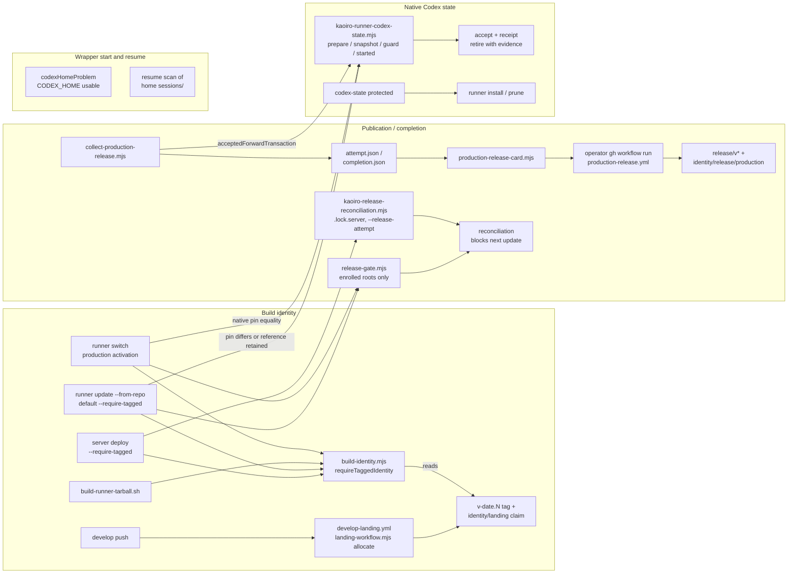

# Reduce release publication and native Codex state protection

Tracking: [issue #709](https://github.com/sakuraiyuta/kaoiro/issues/709)
(parent [issue #704](https://github.com/sakuraiyuta/kaoiro/issues/704)).
Decision record: [ADR-0069](../adr/0069-reduce-release-publication-and-native-state-protection.md).
Base of the analysis: `a51a64ca5200198e9f6226399863b963f00bf3bf`; every
`file:line` refers to that commit.

This page is a design for review. It changes no code, workflow, repository
variable, ruleset, tag or production installation. Each landing unit in
section 7 is a separate issue with its own design review where noted, and
every operator operation it names needs its own approval.

Claims are marked **(measured)** with the probe in section 9, **(read)** when
they come from reading code or documents at the base commit, and
**(unmeasured)** when nothing has established them yet. Nothing in this design
is approved while it depends on an unmeasured premise that section 9 lists as
blocking. Design review rounds and their findings are recorded on the issue;
this revision answers review r1.

## 1. Operator decision this design implements

Operator decision of 2026-10-22, recorded on [issue #709](https://github.com/sakuraiyuta/kaoiro/issues/709):

1. Option A. Stop per-develop-push landing tags and the hourly
   reconciliation. Stop the receipt-to-`workflow_dispatch` identity
   publication and its repository-variable gates. Keep lockstep component
   updates (server and runner at one commit). Release records rely on the
   production release tag and the release note. Option B (component-wise
   release) is not pursued now.
2. Reduce the native Codex state layer to what a wrapper needs to start and
   resume correctly. Everything else needs no strict protection.

Options B and C of the original issue are therefore not developed here.
Option C's "streamline the ordinary path" is subsumed: the ordinary path
shrinks because the layers behind it are removed.

## 2. Three concepts and their dependencies

[Issue #709](https://github.com/sakuraiyuta/kaoiro/issues/709) asks to separate three concepts before deleting anything.

| Concept | What it answers | Current owner (read) |
|---|---|---|
| Build / artifact identity | Which source does this artifact contain? | `scripts/build-identity.mjs`, `with-build-identity.mjs`, frozen identity JSON, `verify-release.mjs`, `--version --json`, health `build_identity_formats` |
| Publication / completion | Was this commit landed, deployed and verified, and is that recorded outside the host? | `develop-landing.yml` + `scripts/landing-*.mjs`; `production-release.yml` + `scripts/production-release-*.mjs`, `collect-production-release.mjs`, `production-runner-worker.mjs`; enrolled branches in the runner updater/switch/bootstrap and the server deploy CLI |
| Native Codex state | Can the Codex binary of the running release open this home and resume its threads? | `runner/deploy/kaoiro-runner-codex-state.mjs`, `codex-snapshot.mjs`, `codex-service.mjs`, `codex-native.mjs`; the Codex branches of `kaoiro-runner-update.sh` / `kaoiro-runner-switch.sh` / `kaoiro-runner-install.sh` |

Call and data dependencies (read):



Consequences for the deletions:

- Build identity depends on landing tags. Stopping allocation without a new
  tag source makes every new commit `untagged`, and production builds and
  `--from-repo` updates refuse it. The replacement tag source (unit P1) must
  land before allocation stops, and the old consumers that read landing
  records on enrolled roots must be out of the way before the first new tag
  (cutover C, section 3.7).
- The completion collector depends on native-state acceptance
  (`acceptedForwardTransaction`, `kaoiro-runner-codex-state.mjs:139`). Removing
  acceptance (unit N2) after the collector is gone (unit P3) avoids a
  temporary compatibility shim.
- Native-state protection does not depend on publication. Removing GitHub
  publication removes no runner Codex state test; the six slow files belong to
  the native-state layer alone (section 6).
- Runner start and resume depend on `CODEX_HOME` usability and on the home's
  contents, not on any `codex-state` record (read: `runner-cli.ts:258-262`,
  `supervisor.ts:1449-1453`, `sessions.ts:606-727`).

## 3. Publication layer (option A)

### 3.1 Current state (measured, 2026-10-22)

- `develop-landing.yml` is active and allocating: 133 runs, the latest
  push and schedule runs succeeded; 68 `identity/landing/*` claims exist.
- `production-release.yml` has 0 runs. `KAOIRO_RELEASE_ENABLED` is `false`.
  No `release/*` or `identity/release/production/*` tag exists. The
  receipt-to-dispatch path has never published.
- The tag ruleset "Kaoiro immutable release identities" is active.
- The production runner installation inspected has no enrollment descriptor
  (`release-authority.json`), no alias map and no `production-attempts/`.
- Server enrollment is **(unmeasured)**; see U2 in section 9.

### 3.2 Guarantees, owners and decisions

| Id | Guarantee | Owner (read) | Decision |
|---|---|---|---|
| G1 | Server and runner are updated to the same commit | runbooks, release note "Upgrading" | keep |
| G2 | An artifact attests its full SHA and dirty flag; one frozen identity feeds every component build; source is checked before and after building | `build-identity.mjs`, `with-build-identity.mjs`, `verify-release.mjs` | keep |
| G3 | A new identity format is not started against readers that lack it | health `build_identity_formats`, fleet snapshot in deploy/update | keep |
| G4 | A production build or forward activation uses an exact tag at HEAD, never an ancestor or a label | `requireTaggedIdentity`, switch activation gate | keep; the tag source changes (P1) |
| G5 | Existing `v*` / `identity/*` / `release/*` tags cannot be moved or deleted | tag ruleset | keep (no ruleset change) |
| X1 | Every successful develop push tip receives a contiguous `vYYYY.MM.DD.N` and a same-object claim; hourly reconciliation repairs missed allocations; operator repair tooling for workflow-permission refusals | `develop-landing.yml`, `scripts/landing-*.mjs` | retire (P2) |
| X2 | A deployment yields a write-once completion receipt bound to server DONE, runner worker facts, registration, Codex acceptance and the canary, published as `release/v*` through operator `workflow_dispatch`; unfinished or unpublished attempts block the next update | `production-release.yml`, `scripts/production-release-*.mjs`, `collect-production-release.mjs`, `production-runner-worker.mjs`, enrolled branches | retire (P2 workflow, P3 code) |
| X3 | Repository-variable gates bind workflow admission to a reviewed control SHA and V9/V10 evidence | `KAOIRO_*` repository variables, `release-automation-gate.mjs` | retire with X1/X2 |

### 3.3 The release tag that replaces landing tags (P1)

The production release tag is created at release time on the commit being
released, before the build. Provisional choice (decision point D1):

- Name: `vYYYY.MM.DD.N`, the existing namespace. Release notes, labels, the
  dashboard and `build-identity.mjs` already use it, and the ruleset already
  protects it. Historical `v*` tags mean "landed"; tags after the cutover mean
  "released". The cutover commit and date are recorded in ADR-0069 and in
  `docs/release/README.md`, so the two meanings are never inferred from the
  name alone.
- Form: an annotated tag whose message is a bounded schema-2 JSON
  `{"schema":2,"kind":"release","revision":"<40-hex>","branch":"develop"}`.
  No claim ref is created.
- Reader: `computeBuildIdentity` / `requireTaggedIdentity` accept an exact
  HEAD `v*` tag that is either a valid historical schema-1 landing pair (as
  today) or a schema-2 release annotation whose `revision` equals HEAD. A
  schema-2 tag with a claim, a conflicting second exact tag, a lightweight
  tag or a mismatched revision refuses, as broken pairs do today. Origin
  read-back of the selected tag stays. A commit that already carries a valid
  historical landing pair is released under that tag; no second tag is
  created for it.
- Numbering: `N` is the next unused number for the UTC day among existing
  `v*` tags. Contiguity is no longer verified; tag-name uniqueness is enforced
  by Git and the ruleset. A small helper (`scripts/release-tag.mjs plan`)
  prints the next name and the `git tag -a` / `git push origin
  refs/tags/<name>` commands; it never pushes.
- Who creates it: the release operator (the operator, or a director whose
  release is approved). Creating `v*` tags needs ordinary Contents-write
  authority; the active ruleset has only `update` and `deletion` rules and no
  bypass actors (measured, read-back 2026-10-22). Until now only the workflow
  bot has created `v*` tags. Creation by each intended principal, credential
  and transport under this ruleset is **(unmeasured)** and is measured in a
  disposable repository before the cutover (U6, section 9). No trial tag is
  created in the real repository's immutable namespaces.
- Landing the reader (P1) and starting to use schema-2 tags (cutover C,
  section 3.7) are separate steps. P1 is additive: with no schema-2 tag in
  existence it changes nothing.

Normal path after C, P2 and P3: choose the commit, write the release note, create
and push the release tag, build with `--require-tagged`, update server then
runner, run the canary, commit the release note. Failure/recovery: a failed
build or deployment leaves the tag in place; redeploying the same commit
reuses it. A tag on a commit that is never deployed is harmless and is noted
in the next release note. A wrong tag is not moved; the malformed-tag
procedure (kept, section 3.5) applies.

Lost by X1: a version for every develop commit (non-release builds become
`untagged / develop / <hash>`), automatic landing evidence independent of the
pusher, and claim-based detection of hand-made `v*` tags (a hand-made `v*`
tag is now the intended release authority).

### 3.4 Retiring X2/X3

Lost: machine-checked completion evidence bound to one receipt; the admission
block on unfinished or unpublished attempts; detection of an omitted
publication; the digest-pinned enrolled tool closure and the retained worker
unit with typed `ExecStartEx` evidence. Since `KAOIRO_RELEASE_ENABLED` is
false and no receipt was ever published (measured), the publication half has
no consumer. The enrolled half has no consumer on the inspected runner; the
server side is U2.

Retained in place of X2: the release note (deployed commit, previous release,
range, class), the release tag, and the existing per-operation checks that do
not depend on enrollment: deploy health/full-SHA checks, runner
`--version --json` attestation and registration match, ordinary `--detach`.

### 3.5 Code, tests, runbook sections that go away

Candidate set (read). Each unit confirms it with an import/reference sweep
before deleting; a file still imported by kept code stays.

| Unit | Code | Tests | Runbook / docs |
|---|---|---|---|
| P1 | none removed; `build-identity.mjs` reader extended, new `scripts/release-tag.mjs` | `scripts/test` build-identity cases extended; `releaseSwitch` "requires a landing tag" case rewritten for the release tag | `build-identity-and-release-tags.md` "Identity" rewritten; `docs/release/README.md` gains the tag step; `runner-update-and-rollback.md` "Build identity preconditions" |
| P2 | `.github/workflows/develop-landing.yml`, `production-release.yml`; `scripts/landing-workflow.mjs`, `landing-tags.mjs`, `landing-backlog.mjs`, `landing-repair*.mjs`, `production-release-workflow.mjs`, `production-release-card.mjs`, `release-automation-gate.mjs`; their entries in `check-release-child-environments.mjs` | `scripts/test/landing-reconciliation.test.mjs`, `landing-repair.test.mjs`, `mock-github-api.mjs`, `fixtures/landing-repair-fixture.mjs`; CI job `release-identity` loses the landing file | `build-identity-and-release-tags.md`: "Automation activation and trust", "Repair", "Recorded repair of a historical landing" removed; "Repairing a malformed reserved tag" kept, shortened |
| P3 | `collect-production-release.mjs`, `production-runner-worker.mjs`, the remaining `scripts/production-release-*.mjs` including `production-release-tags.mjs`; `runner/deploy/release-gate.mjs`; enrolled branches in `kaoiro-runner-update.sh` / `-switch.sh` / `-bootstrap.sh` / `-common.sh`; `release-tools` staging in `build-runner-tarball.sh:203`; `server/deploy/kaoiro-release-reconciliation.mjs` and the enrolled branches / `--release-attempt` argv of `kaoiro-server-deploy.mjs` and `kaoiro-deploy-recovery.mjs:186`; `check-release-child-environments.mjs` if nothing else uses it | `scripts/test/production-release*.test.mjs`, `production-runner-worker.test.mjs` (CI job `release-identity` removed); `runner/test/releaseReconciliation.test.ts`; enrolled-fixture cases of `server/deploy/test/recovery*.test.mjs`, `test-support/fake-release-exporter.mjs` | `build-identity-and-release-tags.md`: "Enrolled production authority", "Common production checkpoint", "Reconciliation and explicit recovery" (with the release state table) removed; matching paragraphs of `runner-update-and-rollback.md`, `server-update-and-rollback.md`, `runner-install.md`, `reference/deployment/transactions-and-identity.md`, `docs/README.md` |

`production-release-tags.mjs` stays until P3: `collect-production-release.mjs`,
`production-release-reconciliation.mjs`, `production-release-lifecycle.mjs`
and `production-runner-worker.mjs` import it (measured by import sweep; the r1
review reproduced the load failure in a disposable copy). The release-tools
staging in `build-runner-tarball.sh:203` follows every import in its scopes
(`production-release-tools.mjs:28,66-106`), so P2's acceptance includes a
tarball build with staging, a load of the retained audit and lifecycle
modules, and `scripts/test/child-process-environment.test.mjs` after the
`check-release-child-environments.mjs` entries are removed.

Sizes at the base commit (measured with `wc -l`): 26 publication scripts,
8,104 lines; 10 publication test files, 4,269 lines; the two workflows, 158
lines. The CI `release-identity` jobs took 15 s and 26 s ([issue #709](https://github.com/sakuraiyuta/kaoiro/issues/709)); their
removal is not a CI-time argument.

### 3.6 Unfinished records and operator operations

- Landing allocations: once `KAOIRO_LANDING_ENABLED=false`, pushes between the
  last allocation and the first release tag stay untagged. They are not
  repaired. Existing pairs remain immutable and readable.
- Repository variables: the operator sets `KAOIRO_LANDING_ENABLED=false` in
  cutover step C3, and deletes the `KAOIRO_*` variables only after P2 has
  removed both workflows and no run of them is queued or in progress (D6).
  `KAOIRO_RELEASE_ENABLED` is already false.
- Ruleset: unchanged. It costs nothing and keeps historical tags immutable.
- Enrolled roots: resolved before the cutover, not before P3 (section 3.7).
  The old consumers that require a schema-1 landing record
  (`production-release-plan.mjs:173-186`, `collect-production-release.mjs:562,597`,
  `production-release-card.mjs:30-34`, and the enrolled audits of the runner
  updater at `kaoiro-runner-update.sh:230-234,360-364,455-459` through
  `release-gate.mjs:20-28`) run only on enrolled roots. Removing enrollment
  before the first schema-2 tag means no old consumer ever reads one. A
  descriptor that reappears after P3 is ignored by the new code; P3 adds one
  warning line when it sees one, so a forgotten root is visible.
- Old tools reading new records: nothing new is written by P1-P3 except the
  schema-2 tag annotation. An older `build-identity.mjs` treats a schema-2 tag
  without a claim as a broken pair and refuses a production build. That is
  fail-closed and only matters for building a post-cutover tag with
  pre-P1 code, which the runbook forbids.

### 3.7 Cutover order (C)

C is a sequence of operator operations, not a code unit. Each step needs its
own approval. Until C1 and C2 are complete, using schema-2 tags and stopping
allocation are **not approved** by this design.

1. **C1, enrollment (U2).** The operator runs the read-only check of
   section 9 on the server and on every runner installation. C1 passes only
   when every installation reports `not-enrolled` (exit 0). Any `unknown`
   stops C1 until the path or permission is fixed and the check rerun. Any
   `enrolled` starts the resolution below, which writes production state and
   therefore needs its own operator approval:
   1. List the attempts without touching production. In a new private (0700)
      scratch directory on the same host, copy the canonical history root and
      its sibling `<root>-inventory.json` with `cp -a`, and make a fresh
      `git clone` of the public repository. Run the old audit from the
      deployed release's tools (its `deploy/release-tools`, or a clean
      checkout of the release commit; not a post-P2 checkout) with
      `--root <copy> --repo <clone>`. The audit can run `git fetch --tags` in
      the clone (`production-release-card.mjs:106-118`); that write stays in
      the scratch directory. Production history, the production checkout and
      the remote are not changed. The history holds private paths and host
      aliases, not credentials; keep the output private and delete the scratch
      directory afterwards. If the audit refuses the copy (for example a path
      or ownership check bound to the original location), the listing is
      `unknown` and C1 stops for an operator decision; the audit is never run
      against the original instead.
   2. Close each unfinished attempt with the same tools (`abandon`,
      `retire-deployed` or `quarantine`). Completed attempts that were never
      published cannot be archived by the old tools (archive needs a
      published pair); they stay in the history unchanged and are not given a
      fabricated publication.
   3. Move the descriptor and the canonical history root, unmodified, to
      private storage on the same host, then rerun the read-only check until
      that installation reports `not-enrolled`.
2. **C2, tag creation (U6).** The disposable-repository measurement of
   section 9 has passed for the principal, credential and transport that will
   create release tags, and the operator has approved that combination.
3. **C3, stop allocation.** P1 is deployed to server and runner. The operator
   sets `KAOIRO_LANDING_ENABLED=false`, then checks U4: no `develop-landing.yml`
   run is queued or in progress, and the next push and the next scheduled run
   skip `publish` without creating a `v*` tag or claim.
4. **C4, first release tag.** The first schema-2 tag is created only after
   C3, so the old allocator and the new writer never compete for the same
   commit or day number. The release under it uses the normal path of
   section 3.3.

Rollback before C4 reverses C3 only: set `KAOIRO_LANDING_ENABLED=true`
again and allocation resumes. Installations de-enrolled in C1 stay
de-enrolled; the reached state is "old allocator running, no enrolled root",
which is accepted because the schema-1 reader stays in P1 and the
publication that enrolled records fed was never enabled
(`KAOIRO_RELEASE_ENABLED=false`, measured). Re-enrolling would be the
enrollment procedure of the pre-P3 runbook, run separately by the operator;
this design does not provide or require it. After C4, the schema-2 tag stays
(immutable) and the P1 reader keeps reading it.

## 4. Native Codex state: the minimal protected boundary

### 4.1 What "wrapper start and resume" needs

A Codex wrapper starts correctly when the runner launches it with a usable
`CODEX_HOME`, the pinned binary can open that home's databases, and the
stored login is valid. It resumes correctly when the home still holds the
thread's rollout under `sessions/` and a state database the binary can read.
From this, the boundary has nine invariants. Everything outside them is
unprotected by design.

| Id | Invariant | Why start/resume depends on it |
|---|---|---|
| B1 | The runner refuses Codex launches when `CODEX_HOME` is unusable, with a reason; state-aware operations require explicit next-start `CODEX_HOME`, and an absent explicit home refuses Codex spawn during replacement | otherwise every wrapper crash-loops (`codex-home.md`) |
| B2 | A switch to a release with a different Codex native hash happens only in one of three forms: (a) **safe forward**: a verified snapshot of the stopped home exists, then the candidate's native opens the home; (b) **never-started return**: the candidate's start was never requested, so the source restarts on the untouched home; (c) **restore**: the candidate's start was requested or its state is unknown, so the home is restored from the snapshot before the source starts. Any other differing-native switch refuses | an older binary on state that a newer binary may have migrated is the start/resume risk (U1); the code-only return in (b) is safe only when the candidate never had the chance to open the home |
| B3 | Restore never brings back older credentials (`auth.json`, `.credentials.json`, `secrets/`, `mcp-oauth-locks/`); the current entries are moved, not copied or read | an older refresh token can be revoked, and the wrapper then cannot authenticate |
| B4 | A snapshot never includes credentials, and unknown home entries refuse rather than being copied blindly | an unrecognized credential-bearing file would be rolled back by restore (B3) |
| B5 | Home state is copied or replaced only while the managed runner is inactive, `MainPID` is 0 and the service cgroup is empty | a live writer makes the SQLite/WAL copy inconsistent |
| B6 | A snapshot is verified against its manifest hash before it replaces the live home | a corrupt copy replaces a working home |
| B7 | Replacing the home is resumable and non-destructive: the old home is renamed aside, never deleted, and an interrupted replacement leaves a record naming both paths | an interruption between the two renames leaves no home at the configured path |
| B8 | Three paths agree as resolved absolute paths: the home the running runner actually uses (the `CODEX_HOME` of its `MainPID`, read while it is active), the home the next start will use (unit environment plus `runner.env`), and the `--codex-home` that is snapshotted or restored. A pin update or restore never doubles as a home relocation; moving the home stays a separately approved operation | the runner's resume scan and the wrapper's SDK resume use the home they actually run with (`runner/src/sessions.ts:608-610,722-730`, `wrapper/codex/src/host.ts:2041-2048`); `runner.env` edited after start can differ from the live environment, so checking only the next-start path can snapshot B while the threads live in A |
| B9 | The release whose native binary a retained snapshot needs is not pruned while the snapshot is retained; a failure before any state change restarts the unchanged source | restoring a snapshot without its binary cannot start; a stopped runner after a harmless failure is an outage |

The refusal part of B2 is enforced whether or not records exist (`guard`
without a transaction refuses a differing native hash,
`kaoiro-runner-codex-state.mjs:209-213`), and this stays. Forms (a)-(c) are
told apart by the durable start intent of S11 (section 4.3), not by an owner
PID or a catch handler: a SIGKILL or power loss between the start request and
the completion record must still route to restore.

Where B8 reads each path: at forward prepare the runner is active, so the
live `MainPID` environment (`captureBinding`, `codex-service.mjs:118-128`) and
the next-start environment (`staticBinding`, `:73-117`) are both compared with
`--codex-home`. Before switch and before start the runner is stopped, so only
the next-start path is re-read and must equal the path recorded at prepare.
A restore that begins with the runner active compares both, as forward does;
one that begins stopped compares the next-start path with the snapshot's
recorded home path. What is dropped is file identity: unit file hashes,
`runner.env` byte hash and device/inode, manager environment and `ExecStart`
text.

Whether to keep cross-pin rollback at all (and hence snapshots) is decision
point D2 (section 8). This design keeps it, simplified: without a snapshot,
the only exit from a bad pin update is fixing forward or a fresh setup that
loses every Codex login and thread, which is exactly a resume failure for all
Codex peers.

### 4.2 Safeguards: keep / simplify / retire

| Id | Safeguard (read) | Invariant | Decision | What changes / what is lost |
|---|---|---|---|---|
| S1 | `codexHomeProblem()` launch refusal; `CODEX_HOME` withheld from non-Codex children and tool shells | B1 | keep | product code, not the state helper |
| S2 | Native pin equality guard in switch/updater (`guard` without a transaction) | B2 | keep | unchanged |
| S3 | Credential exclusion from snapshots and move-not-copy on restore | B3, B4 | keep | the per-credential `credential-intent/moved:<name>` phases collapse into the single replacement record of S11 |
| S4 | Home classification, fail closed on unknown names (`inventory`) | B4 | keep | `codexHomeClassification` stays (1.7 s) |
| S5 | Post-stop check: inactive, `MainPID` 0, empty cgroup (`assertStopped`); unified cgroup v2 required | B5 | keep | |
| S6 | Pre-stop foreign-UID walk of the runner cgroup (`assertOwnedCgroup`) | none | retire (N1) | lost: refusal before stop when a foreign process sits in the cgroup. S5 still refuses after stop and the source is resumed (S13). It never proved snapshot consistency against independent writers, and its removal adds no new permission for such writers |
| S7 | Snapshot manifest and hash verification before replacement | B6 | keep | |
| S8 | SQLite migration-level diagnostics (`codex-snapshot.mjs:132-153`, called at `:165`) and throughput estimate | none | retire (N1) | lost: rollback diagnosis data. The capacity check (bytes and inodes) stays (a full disk breaks start) |
| S9 | Static/live binding: unit file hashes, `runner.env` `sourceHash` and device/inode, manager environment, `ExecStart`, live `MainPID` home binding (`codex-service.mjs:73-135`) | B8 | simplify (N2) | keep the three-way path agreement of B8, including the live `MainPID` path while the runner is active; drop file identity. Lost: refusal on a `runner.env` byte or inode change that leaves the home path unchanged; such an edit no longer strands rollback points. Done in N2, not N1, because `validateReceipt` (`kaoiro-runner-codex-state.mjs:48-56`) requires full binding equality between a transaction and its receipt, and receipts exist until N2 |
| S10 | Acceptance evidence file, binding receipt, `sequence`, `awaiting-acceptance` gate | none | retire (N2) | the updater completes the forward after its own post-start check (active, `MainPID`, attested release). Lost: an operator attestation that Codex started and history resumed before the next update; it becomes a runbook check, not a gate. The durable start intent of S11 is a different thing and stays |
| S11 | 16-phase transaction machine plus owner PID/start-tick proofs (`codex-owner.json`) | B2, B7, B9 | simplify (N2) | forward: `prepared` → `snapshot-verified` → `start-intent` → `completed`, or `failed` from `prepared`/`snapshot-verified` only; restore: `restore-prepared` → `replace-intent` → `restored`. `start-intent` is saved durably before the start request, as `start-attempted` is today (`kaoiro-runner-codex-state.mjs:292-305`, `kaoiro-runner-update.sh:549-557`). The `.lock.update` directory stays the mutual exclusion; the updater PID is recorded for diagnosis only |
| S12 | Restore lineage: newest-unrestored rule, `acceptedHome`, `recoveryLineage`, chained restores | none | retire (N2) | restore takes an explicitly named retained snapshot whose source native equals the release being started. Lost: refusal to restore an older snapshot when a newer one exists; restoring an older snapshot quarantines newer threads, as restore already does |
| S13 | Code-only recovery for a never-started candidate; unchanged-source restart (`restartSource`) | B2, B9 | simplify (N2) | one rule over the durable phase: `prepared` or `snapshot-verified` (start never requested) → restart the source on the untouched home; `start-intent` without `completed` (started or unknown) → restore from the snapshot. An updater death is classified by the saved phase alone |
| S14 | Legacy (pre-receipt) record handling and ignored `barriers/` | none | retire (N2) | the new helper refuses while any old record is non-terminal or any old reference is unretired (section 4.4) |
| S15 | Retirement with a gate-6 evidence file; `abandon` with owner-state checks | none | simplify (N2) | `prune <root> <uuid>` deletes a retained snapshot and marks it retired, no evidence file. A forward that failed before writing its snapshot is `failed` and does not block the next update, so `abandon` disappears |
| S16 | Release prune protection for references and unfinished transactions (`protected`) | B9 | keep (N2) | narrowed to retained snapshots' source releases; unfinished forwards additionally protect source, target and physical tool, and unfinished restores protect source, admission release and tool; terminal records release historical target/tool protection |
| S17 | `acceptedForwardTransaction` export for the completion collector | none | retire (N2, after P3) | P3 removes the collector consumers; N2 removes the export and its direct test |
| S18 | Snapshot privacy (0700/0600, same user), restore at the original canonical path | B3, B8 | keep | |

The result keeps nine invariants with one small record type, and drops the
registry-wide validation that makes every scan refuse on one malformed field.

### 4.3 Failure paths of the reduced design

| Failure point | State left | Exit |
|---|---|---|
| Classification, capacity or path check fails before stop | nothing; source running | fix the cause, retry |
| Stop leaves a process in the cgroup | forward `prepared`; source stopped | updater restarts the unchanged source, records `failed` |
| Snapshot copy or verification fails | forward `failed`; staging removed when possible, else named in the record | source restarted; a leftover staging directory is reported by the next update (warning, not a refusal) |
| Switch fails before `start-intent` is saved | forward `snapshot-verified` | never-started return (B2 b): source restarted on the untouched home; record `failed` |
| Updater killed after `start-intent` is saved, before or after the start request | forward `start-intent` | started-or-unknown: staying on the target is safe, so either finish the forward (the target is `current` and passes the post-start check, then `completed`) or restore from the snapshot before any source start (B2 c). A code-only return to the source refuses |
| Candidate start fails or its post-start check fails | forward `start-intent` | restore from the snapshot (B2 c); the updater reports a failed update |
| Candidate started and checked, then the operator wants the old code | forward `completed`, snapshot retained | `--restore-codex-backup <snapshot>`: stop, verify, move credentials, rename home aside, promote, start source release |
| Restore interrupted at any rename or credential move | restore `replace-intent` naming home, staging, aside paths and the credential entries | rerunning the same restore finishes or reverses the step from the observed filesystem state; N2's design shows the exit from each interruption point (the current per-credential phases, `codex-snapshot.mjs:193-211`, are the reference); the runner refuses Codex launches meanwhile (B1) |
| Restore cannot succeed | home or staging preserved | fresh setup (`codex-home.md`), unchanged |

The `completed` record means the updater's own post-start check passed
(active service, `MainPID`, attested release). It does not prove that a
Codex turn ran or that an old thread resumed; that remains a runbook check
(D3).

The runner-side transaction table that [issue #695](https://github.com/sakuraiyuta/kaoiro/issues/695) L2/L3 planned for the
current machine is re-derived for this smaller machine (section 5).

### 4.4 Existing records and cutover

- Inspected production runner (measured): every recorded Codex state
  transaction is terminal (`retired`) and every backup reference is retired
  with its snapshot deleted. No restore has ever been recorded. Other runner
  installations are **(unmeasured)**, U3.
- The reduced helper writes `codex-state/v2/`. The old `transactions/` and
  `backups/` directories are left untouched. Before any state-aware action
  the new helper reads only `phase` of old transactions and `retired` of old
  references; any non-terminal transaction or unretired reference refuses with
  "Resolve old Codex state records with the previous tool release". That
  exit uses the last pre-N2 tool release, which N2's runbook names; the new
  helper never converts or edits old records.
- An old helper does not read `v2/`, and its `protectedReleases`
  (`kaoiro-runner-codex-state.mjs:31-33,379-388`) lists only releases named by
  old records, so the old updater's prune (`kaoiro-runner-update.sh:616-640`)
  can delete a release that a v2 snapshot needs. Returning to pre-N2 code is
  therefore allowed only with no v2 snapshot retained and no v2 replacement
  in flight: prune or restore every v2 snapshot first. Under that condition a
  same-native code-only rollback needs no state copy. With a retained v2
  snapshot or an in-flight replacement, N2's design states for each path
  (automatic recovery, manual `--rollback`, a code revert) which tool release
  is used and which operation is refused; keeping an old tool release around
  is not by itself a way back.
- Stopping and restarting the agent that may initiate an update: unchanged.
  The update is queued with `--detach` from the new release's physical tool
  path and the agent ends its turn after enqueue.

## 5. Relation to issues #695, #707 and #704

**[Issue #695](https://github.com/sakuraiyuta/kaoiro/issues/695) L1b, L4, L5 (server side): not affected by the native-state
boundary.** They change the server deploy transaction (destructive rollback
resume, 5-b acknowledgement, compose override hashes). None of them reads or
writes Codex state. They do touch the same files as P3's server part: the
enrolled `.lock.server` path, the `--release-attempt` argv emitted by
`kaoiro-deploy-recovery.mjs:186`, and the enrolled fixture of the server
property test (issue-695 plan section 7.1 item 8). Recommendation: L1b, L4
and L5 continue as designed but add no new enrolled-specific behavior. P3
lands after them, or rebases onto them if it is ready first, and removes the
enrolled rows from the server property test in the same change. L1b's live
fleet admission uses `build_identity_formats` (G3), which stays.

**[Issue #695](https://github.com/sakuraiyuta/kaoiro/issues/695) L2, L3 (runner side): one contract, not two machines.**
They stay on hold, as the operator decided, and no state of the retired
machine (sections 3.2 and 5.4 of the issue-695 plan) is implemented. The
reduced machine of section 4.3 (eight states) is the only runner contract.
N2 implements it with its own exits; N3 adds the runner recovery table and
property test over it. Whether N3 keeps the L2/L3 issue numbers or closes them
as superseded is the director's call (D4); either way each runner defect of
the issue-695 plan (section 4.2) is carried, not dropped:

| issue-695 defect | Where it is closed in the reduced contract |
|---|---|
| R1 `prepared` without a named exit | N2: a pre-snapshot failure records `failed` and does not block; N3: the hint names the command |
| R2 `stopped` residues ([issue #531](https://github.com/sakuraiyuta/kaoiro/issues/531)) | N2: the operator decision of 2026-10-20 carries over (delete exactly the recorded staging path, record its path and size); a complete snapshot without its record and a record without its snapshot each get an exit in N2's design |
| R3 killed worker at `snapshot-verified` needs a live lock owner | N2: never-started return is chosen from the durable phase alone (S13), with the existing stale-lock inspection |
| R4 intermediate restore phases without exit | N2: `replace-intent` is resumable from each interruption point (section 4.3) |
| R5 `awaiting-acceptance` hint | retired with S10 |
| R6 refusals name no command or runbook anchor | N3: the recovery table is the single source of hints |
| R7 `retire` killed mid-removal cannot rerun | N2: `prune` records its intent before deleting and a rerun accepts a partly removed snapshot |

**[Issue #707](https://github.com/sakuraiyuta/kaoiro/issues/707): do not start; propose closing it as superseded.** Its targets `staticShape`,
`validateReceipt` and `validateTransactionState`
(`kaoiro-runner-codex-state.mjs:35-73`) are retired by N2, and its
test file `codexReceipt.test.ts` is deleted. The record checks that remain are
small and live in the fast `codexState.test.ts`. If the CI measurement after
N3 still shows the workflow file as a bottleneck, a new, narrowly scoped issue
is opened against the new code. Proposing the close is not the same as the
target being retired: that happens when N2 lands.

**[Issue #704](https://github.com/sakuraiyuta/kaoiro/issues/704):** [issues #705](https://github.com/sakuraiyuta/kaoiro/issues/705) and [#706](https://github.com/sakuraiyuta/kaoiro/issues/706) are unaffected. The CI measurement that
the operator scheduled after [#709](https://github.com/sakuraiyuta/kaoiro/issues/709) and [#705](https://github.com/sakuraiyuta/kaoiro/issues/705) lands is taken after N3.

## 6. The six slow runner test files

Measured in CI run 39747478279 (job 119719445581): 172 tests, 1,471.904 s
accumulated.

| File | Tests | Accumulated | Fate | Unit |
|---|---|---|---|---|
| `codexStateWorkflow.test.ts` | 59 | 396.878 s | rewritten: keep cases for B2, B3, B5, B6, B7, B8, B9, capacity and stop-failure control flow (about 15); delete acceptance, retirement-evidence, `runner.env` identity, crossed-metadata and abandon cases | N1-N3 |
| `codexLineagePending.test.ts` | 8 | 260.690 s | deleted | N2 |
| `codexLegacy.test.ts` | 10 | 216.326 s | deleted; one fast case for the old-record cutover refusal goes to `codexState.test.ts` | N2 |
| `codexReceipt.test.ts` | 39 | 205.019 s | deleted | N2 |
| `codexLineage.test.ts` | 7 | 200.270 s | deleted | N2 |
| `codexForeignUid.test.ts` | 49 | 192.721 s | deleted; keep cases move to `codexStateKeepSafety.test.ts` and the post-stop population case ("still active after stop → no switch, source resumed") moves to the workflow file | N1 |

Supporting files `codexLineageHarness.ts` and `codexCgroupFixture.ts` are
deleted or reduced with them. `codexState.test.ts` (35 tests, 5.7 s) keeps
its snapshot and pin-guard cases and loses the three barrier cases.

Estimate, not a measurement: the rewritten workflow file at the current
per-case cost (about 6.7 s) would accumulate roughly 100 s, against
1,471.904 s today. Accumulated time is not wall time; the runner job wall time
after N3 is measured, not predicted ([issue #704](https://github.com/sakuraiyuta/kaoiro/issues/704) decision).

## 7. Landing units

One unit at a time, each independently revertible. "Operator op" items are
performed by the operator after review, never by an agent.

| Unit | Content | Depends on | Design review | Operator op |
|---|---|---|---|---|
| P1 | Release-tag reader (schema 2) and `scripts/release-tag.mjs plan`; runbook and release README. Additive: no schema-2 tag exists yet | — | this design, plus the annotation grammar | deploy P1 to server and runner |
| C | Cutover (section 3.7): C1 enrollment resolved (U2), C2 tag creation measured (U6), C3 allocation stopped and idle (U4), C4 first schema-2 tag | P1 deployed | this design | every step |
| P2 | Delete the two workflows, landing scripts, card/workflow scripts and their tests; docs (`production-release-tags.mjs` stays for P3) | C complete | this design | delete `KAOIRO_*` repository variables once no run of either workflow is queued or in progress |
| P3 | Delete completion/enrollment code in scripts, runner updater/switch/bootstrap, tarball staging and server deploy; tests; docs | P2; after [#695](https://github.com/sakuraiyuta/kaoiro/issues/695) L1b/L4/L5 or rebased on them | own short design (server and runner launch paths are high-risk: FS class) | none (enrollment was resolved in C1) |
| N1 | Retire the foreign-UID walk (S6) and the migration/throughput diagnostics (S8). No record, binding or receipt changes | — (parallel to the P chain; it touches `codex-state.mjs` / `codex-service.mjs` / `codex-snapshot.mjs`, not the updater's release branches) | this design | none |
| N2 | `v2/` records and the reduced phase machine with the durable start intent and the cutover refusal (S11); B8 path agreement replacing file identity (S9); retire acceptance, receipts, lineage, legacy, barriers, evidence-gated retirement and `abandon` (S10, S12, S14, S15, S17); `prune`; never-started rule from the durable phase (S13); narrowed release protection (S16); exits for issue-695 R1-R4 and R7 | N1; P3 (collector gone); U3 on each host before deploying there | own design round (record format and helper rewrite), with the phase/record/lock lifecycle observed once in a disposable environment before approval | none |
| N3 | Runner recovery table and property test for the reduced machine, replacing [#695](https://github.com/sakuraiyuta/kaoiro/issues/695) L2/L3; final runbook rewrite | N2 | own design round (it replaces the L2/L3 design) | none |

Each N unit is a Codex state change on the runner's update path and follows
`high-risk-change-release.md` when deployed. Each one is validated with the
real updater against a disposable home: one forward across differing native
hashes, one restore, and the negative controls of section 10. N1 changes no
record, so reverting it needs no data handling. N2 must be safe on its own
when it lands: the start intent and the restore exits are part of N2, not
deferred to N3.

Estimated implementation size (estimate): P1 small; P2 deletion-heavy; P3
medium (touches high-risk launch paths); N1 small; N2 large (the helper
core); N3 medium. C is operator time only.

## 8. Decision points (provisional conclusions)

| Id | Question | Provisional | Alternatives |
|---|---|---|---|
| D1 | Name of the production release tag | keep `vYYYY.MM.DD.N`, created at release time | `release/vYYYY.MM.DD.N` (namespace already protected, but the version source and labels need a second change) |
| D2 | Keep cross-pin rollback (snapshots) | keep, simplified; a conservative choice while U1 is unmeasured, not a claim that old natives fail. Final choice: operator | retire snapshots; keep only B1/B2/B5; cross-pin rollback means fresh setup and loses every Codex login and thread |
| D3 | After a pin update, wait for an operator check before the next update | no gate; the runbook asks for a first-turn and resume check. The durable start intent (S11) is not this gate and stays | keep a one-line `confirm <uuid>` without an evidence file |
| D4 | Runner recovery after the reduction | one contract: the reduced machine (N2) plus its table and property test (N3); no state of the retired machine is built; issue-695 R1-R7 and [issue #531](https://github.com/sakuraiyuta/kaoiro/issues/531) are carried (section 5) | the director decides whether N3 reuses the L2/L3 issue numbers or closes them as superseded |
| D5 | Unknown home entries | keep fail-closed (S4) | copy unknown entries and warn; accepts the B3 risk for new credential files |
| D6 | Repository variables after P2 | delete, once both workflows are removed and no run of either is queued or in progress | leave them in place (harmless, but misleading) |

## 9. Unmeasured premises and probes

| Id | Premise | Blocks | Probe (read-only or disposable) |
|---|---|---|---|
| U1 | An older Codex native cannot reliably open or resume a home migrated by a newer native | nothing (B2 is kept either way); must be measured first if it is ever used to drop snapshots (D2) | in a disposable directory, install two Codex pins from npm. Controls first: new→new and old→old, each starting `codex app-server` on an empty `CODEX_HOME`, creating a thread, stopping, restarting the same pin and resuming it; record the thread id, the rollout file under `sessions/` and the `_sqlx_migrations` rows. Only a thread that both controls show as persisted and resumable is then used for new→old: the newer pin creates and persists it, the older pin opens the same home and calls `thread/list` and `thread/resume`. Record exit codes and errors; no model turn is needed |
| U2 | No server or runner installation is enrolled, and no canonical history holds unfinished attempts | C1 (before the first schema-2 tag and before allocation stops) | the operator runs the read-only check below on the server and on every runner installation; `unknown` stops C1 |
| U3 | Every other runner installation has only terminal Codex state records | N2 deployment on that host | on each runner host, read `phase` of `codex-state/transactions/*.json` and `retired` of `codex-state/backups/*.json` (field projection only; the records hold paths and environment, so never print them whole) |
| U4 | Disabling `KAOIRO_LANDING_ENABLED` makes push and schedule runs skip allocation, and no allocation is still running | C3 | read: the `publish` job condition requires the variable (`develop-landing.yml:42-50`). Before C4: `gh run list --repo sakuraiyuta/kaoiro --workflow develop-landing.yml --status queued` and `--status in_progress` both empty; the next push run and the next scheduled run (minute 17 of the hour) show `publish` skipped; `git ls-remote --tags origin 'refs/tags/v*' 'refs/tags/identity/landing/*'` lists the same refs as before the change |
| U6 | Each intended principal can create an annotated `v*` tag under the same ruleset, through its real credential, transport and harness, and cannot move or delete it | C2 (C3 and C4 are unapproved until it passes for the principal that will create release tags) | disposable-repository plan below; the repository needs operator approval and is created by the operator |
| U5 | The CI wall-time effect of N1-N3 | none (reporting) | compare runner job wall time and accumulated test time on the N3 candidate with run 39747478279 |

U2, read-only check for the operator. It only resolves a directory and
tests whether two names exist; it opens no file, prints no file content and
writes nothing. Run it once per installation: the server directory the
deploy CLI manages, and every runner install root.

```sh
# Usage: u2_check server|runner <absolute install root>
# Prints one line. Exit 0 not-enrolled, 10 enrolled, 2 unknown (stop C1).
u2_check() {
  case $1 in
    server) n=.kaoiro-release-authority.json ;;
    runner) n=release-authority.json ;;
    *) echo "unknown: role must be server or runner"; return 2 ;;
  esac
  case $2 in
    /*) ;;
    *) echo "unknown: root must be an absolute path"; return 2 ;;
  esac
  r=$(cd -P -- "$2" 2>/dev/null && pwd -P) ||
    { echo "unknown: cannot resolve $1 root"; return 2; }
  { [ -r "$r" ] && [ -x "$r" ]; } ||
    { echo "unknown: $1 root is not readable"; return 2; }
  if [ -e "$r/$n" ] || [ -L "$r/$n" ]; then echo "enrolled"; return 10; fi
  if [ "$1" = runner ] &&
     { [ -e "$r/production-attempts" ] || [ -L "$r/production-attempts" ]; }
  then echo "enrolled: production-attempts present"; return 10; fi
  echo "not-enrolled"; return 0
}
```

```sh
u2_check server <server-dir>; echo "exit $?"
u2_check runner <install-root>; echo "exit $?"
```

| Output and exit | Meaning | C1 |
|---|---|---|
| `not-enrolled`, 0 | the directory exists and is readable, and neither name exists | this installation needs nothing |
| `enrolled`, 10 (including a dangling descriptor link, or `production-attempts` on a runner) | old enrolled consumers can run here | resolution steps of section 3.7 apply |
| `unknown: ...`, 2 | the root could not be resolved or read (missing, not a directory, not readable, relative, empty) | C1 stops; fix the path or the permission and run the check again. `unknown` is never counted as `not-enrolled` |

C1 passes only when every installation returned `not-enrolled` with exit 0.
The check was run against disposable directories on 2026-10-22 under bash and
dash (section 10). It does not tell which attempts are unfinished; that is
part of the resolution steps, which never run the old audit against the
production history or a production checkout (section 3.7).

U6, disposable-repository plan (the operator approves and creates the
repository; no tag is created in the real repository):

1. The operator creates a private throwaway repository and applies the
   same ruleset body as the real one: target `tag`, the four include
   patterns of section 3.1, rules `update` and `deletion`, no bypass actors.
   Read it back with `gh api repos/<owner>/<repo>/rulesets` and compare.
2. Positive control, per row, each with its own unused tag name (the `N`
   column below), so no two rows share an immutable object. Before: `git
   ls-remote --tags origin refs/tags/<name>` is empty. Create and push one
   annotated schema-2 tag with the row's credential and transport. After: the
   same `ls-remote` lists it, and `git cat-file -t <name>` in a fresh clone
   prints `tag` (an annotated object, not a lightweight ref). Expected:
   created.
3. Negative controls, **operator row from an OS shell outside any agent
   only**: force-push the operator row's tag name to another commit, and
   delete it. Expected: both refused by the GitHub ruleset, with GitHub's
   rule-violation message. The agent row never attempts a force push or a
   deletion: agents must not try a force push at all (the operator's Git
   rules), and a refusal by the agent harness is not evidence about the
   ruleset. The record names the layer that refused each attempt (GitHub
   ruleset or agent harness).
4. Record a lightweight `v*` tag push once, from the operator row. GitHub is
   expected to accept it; the P1 reader must refuse it (section 10), so this
   is a reader control, not a ruleset one.
5. Record per row: login, transport, tag name, result, refusing layer and
   time, privately. A public evidence page, if any, names no host or path.
   The operator deletes the throwaway repository afterwards.

| Principal | Credential | Transport | Tag name | Negative controls |
|---|---|---|---|---|
| operator, OS shell | the operator's existing SSH key | `git push origin refs/tags/<name>` | `v2099.01.01.1` | yes (step 3) |
| operator | the operator's `gh` login | `gh api` create-ref (only if the operator wants this path) | `v2099.01.01.2` | no |
| director agent session | the agent host's Git credential | `git push` of a new tag through the agent harness, under its permission rules | `v2099.01.01.3` | no (creation only) |

The ruleset's update and deletion refusals are proven once, by the operator
row; they do not depend on who created the tag, because the ruleset has no
bypass actors (read-back, section 3.1).

Only the row that will actually create release tags must pass before C3.

## 10. Verification plan

- P1: build-identity unit cases for schema-1 pairs (unchanged), schema-2
  release tags, and refusals: lightweight tag, schema-2 plus claim,
  mismatched revision, two exact tags. Negative control: a schema-2 tag on a
  different commit must leave the build `untagged` and `--require-tagged`
  must exit non-zero. Real entry: `with-build-identity.mjs --require-tagged`
  and `build-runner-tarball.sh --require-tagged` in a disposable clone with a
  local tag.
- U2 check (run 2026-10-22 against disposable directories, bash and dash):
  `not-enrolled`/0 for an existing root without either name and for a root
  reached through a symlink; `enrolled`/10 for a server or runner
  descriptor, a dangling descriptor link and a runner `production-attempts`
  directory; `unknown`/2 for a missing root under a missing parent (the r2
  review's counterexample, which the previous command reported as
  `not-enrolled`), a regular file, a root without read permission, an
  execute-only root, a relative path, an empty argument and an unknown role.
  The same cases are rerun on the final text before C1.
- P2/P3: reference sweep (`grep` for every removed module name) shows no
  importer; full suite and CI on the candidate; the runner update and server
  deploy happy paths still pass their existing tests. Negative control: a
  leftover descriptor produces the warning and is otherwise ignored.
- N1: the foreign-UID and diagnostics code is gone and the remaining
  workflow cases pass; records written before and after N1 are readable in
  both directions, so a revert needs no data step. The old reader is exercised
  against a new snapshot, and the new reader against a schema-1 manifest with
  `migrationLevels`.
- N2, start intent: kill the updater just before saving `start-intent` →
  never-started return; kill after saving it and before the start request,
  and again after the start request and before `completed` → a code-only
  return to the source refuses and restore (or finishing the forward)
  succeeds.
- N2, B8: live home A with next-start home B is refused before stop (the r1
  review's probe shape, through the new code); a `runner.env` edit that keeps
  the path, and an inode-only change, are accepted; the records written in
  those cases are read back by the N2 reader.
- N2, restore: an interruption at each rename and each credential move is
  resumed by rerunning the same restore.
- N1-N3: per invariant, one failing case through the real updater entry:
  B2 differing native without snapshot refused before stop; B3 restore keeps
  the current `auth.json` bytes; B5 active service after stop leads to no
  switch and a resumed source; B6 corrupt snapshot refused before
  replacement; B7 kill between renames, rerun completes; B8 wrong home
  refused before stop; B9 the snapshot's source release survives prune.
  Cutover: an old non-terminal record refuses with the documented message;
  an all-terminal old registry passes.
- Docs: each removed runbook section has no remaining inbound link
  (`grep` for the anchor).

## 11. Documents to update

ADR-0066 (status: partly superseded by ADR-0069); ADR-0069 (accepted once
reviewed); `docs/operations/build-identity-and-release-tags.md`,
`runner-update-and-rollback.md`, `codex-home.md`, `server-update-and-rollback.md`,
`runner-install.md`, `production.md`, `high-risk-change-release.md`;
`docs/reference/deployment/transactions-and-identity.md`;
`docs/release/README.md`; `docs/README.md`; the issue-695 plan (section 8 unit
table). Each unit updates only the sections it changes.

## 12. Rollback of this decision

This page and ADR-0069 change no runtime behavior. P1 is additive (the old
reader path stays for schema-1 pairs). Re-enabling landing allocation after P2
means restoring the deleted workflow and scripts from Git history and setting
the variables again; historical tags are untouched throughout, so no identity
needs repair. N1-N3 cannot restore deleted acceptance or lineage records that
were never written; a revert brings back the code, and the old helper still
reads the old directories, which N2 leaves untouched.
